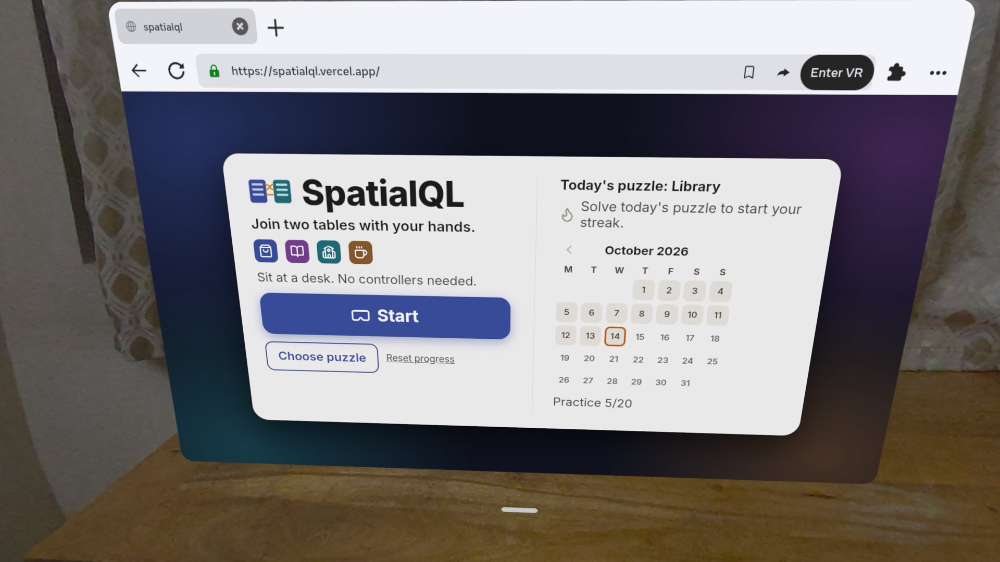
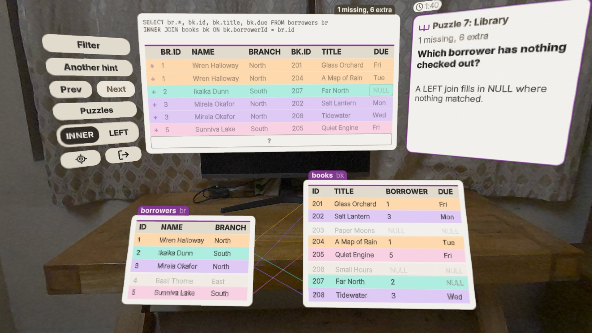
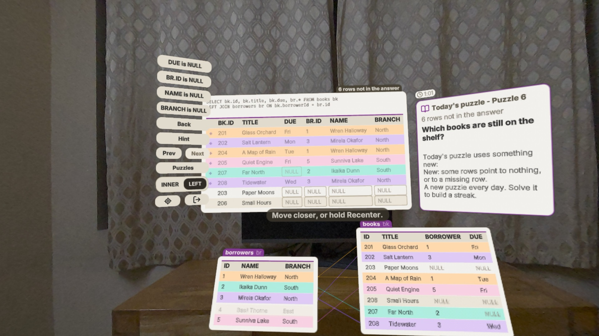
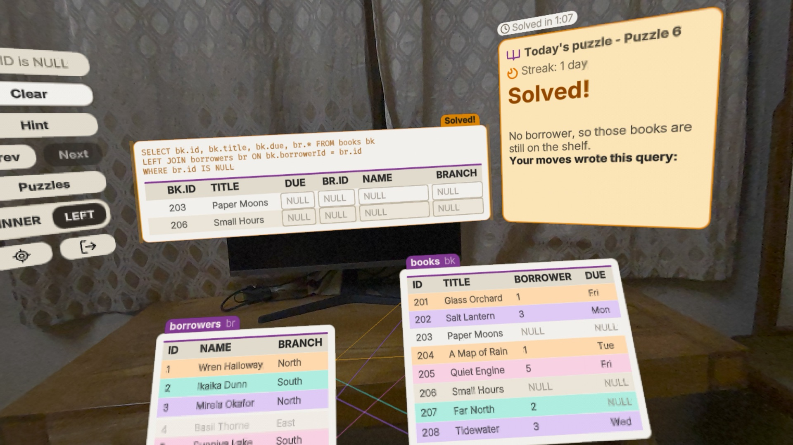
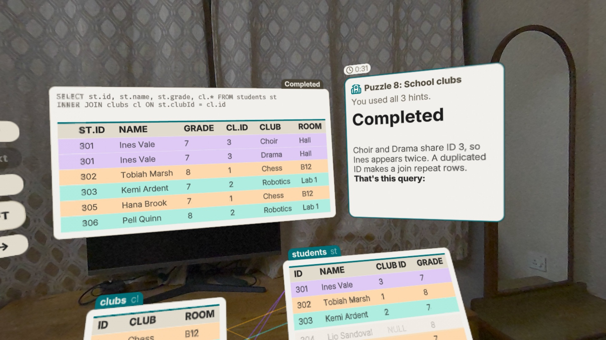
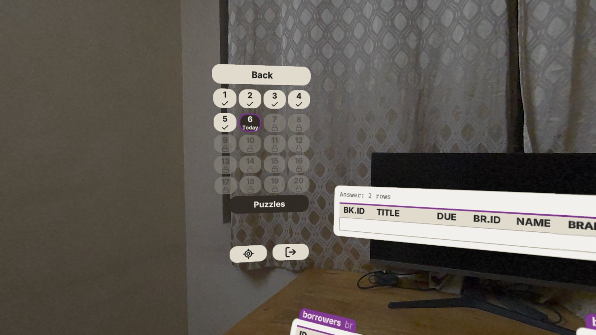

# SpatialQL — SQL joins you can hold

SpatialQL is a hands-first mixed-reality puzzle app for Meta Quest that teaches SQL joins by having you physically bring two tables together on your real desk. Pinch a table, move it to the other, let go: matching rows light up in the same color, link up, and fly into the result, with the SQL you just "wrote" shown beneath it. It's for anyone learning SQL, or anyone who uses joins but has never quite pictured what INNER, LEFT and NULL actually do to rows.

- **Live app:** <https://spatialql.vercel.app/> (open it in the Meta Quest Browser)
- **Competition:** Meta VR Start Developer Competition 2026, Productivity track, New Experience division

## Screenshots

All taken on a Meta Quest 3 in passthrough, at a real desk.


*The welcome page: today's puzzle, the streak and the month calendar, and Start.*


*Joining two tables: matching rows share a color and link up, and the result shows the SQL and how far it is from the answer.*


*LEFT JOIN: unmatched books keep NULLs, and the Filter chips offer each NULL column.*


*Solved: the query your moves wrote, "Solved in 1:07", and the daily streak.*


*A fan-out: two clubs share an ID, so one student appears twice; the card explains why.*


*The puzzle picker in the column: solved, today's, and locked puzzles.*

## How to play

1. Open <https://spatialql.vercel.app/> in the **Meta Quest Browser**, sit at a desk, and press **Start**. No controllers needed. Look straight ahead for a moment while the tables appear in front of you.
2. Read the puzzle card: it says what result to make, and its target outline shows the shape.
3. Reach out and **pinch** a table, bring it to the other, and **let go**. The tables snap together and the join plays out.
4. Choose **INNER** or **LEFT** on the switch in the column on the left. Pull a table away to undo the join.
5. When the result has NULLs, press **Filter** and pick a chip (e.g. `O.ID is NULL`), or poke a NULL cell in the result.
6. Stuck? **Hint** gives a hint, then **Another hint**, then **Show answer**: hold it until its ring fills (a quick press says to hold it). A puzzle finished after Show answer, or skipped, is marked "Answer shown"; solving it later without the answer turns it into a solve.
7. **Prev**, **Next** and **Puzzles** move between puzzles. The **Puzzles** grid (and **Choose puzzle** on the welcome page) marks each puzzle, with a legend under the grid: the current one (filled, with a dot), today's daily (outlined, "Today"), solved (a check), answer shown (an eye) and locked (a lock). On the welcome page, tap a picked puzzle again to clear the pick. **Recenter** brings everything back in front of you and **Exit** ends the session; both act only when held.

Start with three short practice puzzles; after that a **daily puzzle** appears each day. Solving it builds your **streak**, which the welcome page shows on a month calendar. There are **20 puzzles** across four fictional datasets: Corner shop, Library, School clubs and Cafe.

## Features

- **The join, made physical:** the slabs snap together, rows with the same key share a color, match lines fan out, and the result assembles row by row from its source rows.
- **The SQL as you go:** the result's caption shows the query your join and filter amount to.
- **INNER and LEFT,** switchable at any time, with unmatched rows dimming or staying and filling with NULLs.
- **The NULL filter:** WHERE … IS NULL from a Filter chip or a poke on a NULL cell.
- **20 puzzles with a concept ladder:** INNER, LEFT, which table is LEFT, fan-out, anti-joins, NULL keys and stored NULLs; each puzzle shows its target outline and marks extra and missing rows.
- **Daily puzzle and streak:** one puzzle a day after practice, a streak with milestones, and a month calendar on the welcome page.
- **Session clock:** how long you've played this session above the card, and "Solved in" for each puzzle (paused while the headset is off).
- **Hands-first input:** poke buttons and cells with a fingertip, pinch to grab or press, or point and pinch from a distance.
- **Seated layout, anchored to where you sit:** everything is placed once in front of you and stays put; Recenter is the only way to move it.
- **Desk awareness in passthrough:** a detected desk becomes part of the scene; the tables rest on it when it's close enough, and otherwise float above it, casting soft shadows on it.
- **Sound design:** snaps, ticks, wins and milestones, all synthesized with Web Audio.

## Design decisions

- **Hands-first and seated.** Everything is built for a player sitting at a desk with bare hands: no controllers, nothing to walk to.
- **Reach and view limits.** Every button is within seated reach (about 0.5 m), and the whole group fits a comfortable view window (±42° wide, 80° tall around a natural 4° downward gaze). These limits are checked by tests and by debug readouts.
- **Text sized by viewing angle.** Fonts are computed from the angle they should subtend at their planned distance (rows 1.15°), so text reads the same wherever an element sits.
- **The layout anchor.** One anchor (where you sit and face) is set when tracking has settled and on Recenter; every placement is computed from it. Head movement never moves anything, and a guard test fails if placement code reads the live head.
- **Only pressable things highlight.** Hover feedback appears only on buttons, chips and NULL cells, so a highlight always means "you can press this."
- **Protection against accidental presses.** Recenter, Exit and Show answer act only when held, and presses need a deliberate fingertip approach; a stray pinch never moves the group or ends the session.
- **Feedback instead of a buzzer.** The result is compared with the puzzle's target: a target outline, extra and missing rows marked, and a short status line. You see what's off rather than hearing "wrong."

## Tech stack

- [Immersive Web SDK (IWSDK)](https://iwsdk.dev) on WebXR, with Three.js
- UIKit (`@pmndrs/uikit`) for spatial UI; Lucide icons
- TypeScript, Vite, Vitest
- Web Audio: every sound is synthesized at runtime (no audio files)
- Deployed on Vercel from `main`

## Architecture

The **data layer** (`src/data/`) is pure TypeScript with no scene code, and is tested in Node: the join engine with row lineage, the datasets and puzzles, puzzle validation and solvability checks, daily puzzle selection, and progress and streak. The **scene layer** (`src/`) is IWSDK systems that place and animate everything, and read the data layer.

```
src/
  index.ts              World.create() and the systems
  data/                 pure: joins, puzzles, progress, copy (all UI text)
    join.ts             the join with row lineage
    puzzles.ts          the 20 puzzles and the concept ladder
    puzzle-checks.ts    validation: every puzzle solvable as intended
    daily.ts            daily puzzle selection
    progress.ts         progress, streak and history
    copy.ts             every user-facing string
  layout-anchor.ts      the one anchor every placement comes from
  pair-placement.ts     where the two tables go (pure, tested)
  desk-placement.ts     the tables: placement, Recenter, dataset switches, desk shadows
  join-system.ts        the join: grab, dock, result, column, sequences
  challenge-system.ts   puzzles: the card, the bar, hints, wins, the daily
  challenge-view.ts     the card and bar UI
  welcome-page.ts       the browser welcome page (HTML)
  sound.ts              synthesized sounds
docs/                   status, deployment, plans, testing notes
```

## Running locally

Prerequisites: Node 22.12.0 (see `.nvmrc`).

```sh
npm install
npm run dev          # starts the dev server and opens the desktop emulator
```

`npm run dev` opens a managed browser with IWSDK's Quest emulator (IWER), so you can play on a desktop. To try it on a Quest over Wi-Fi, open the network URL from `npx @iwsdk/cli dev status` in the Quest Browser and accept the local certificate; [`docs/DEPLOY.md`](docs/DEPLOY.md) has the details and the production checks.

```sh
npm test             # unit tests (Vitest)
npm run typecheck    # TypeScript
npm run build        # production build into dist/
```

## Dev tools

Dev builds include debug flags (e.g. `?debug=1`), an in-headset debug panel, keyboard shortcuts for the join and puzzles, and a log sink that writes headset sessions to `logs/` with a code stamp. None of it ships: production builds drop it, and `docs/DEPLOY.md` lists the check that proves it. See [`docs/grab-debug.md`](docs/grab-debug.md) for testing steps and [`docs/STATUS.md`](docs/STATUS.md) for what's built and verified.

## Credits and license

All data in the puzzles (customers, orders, books, borrowers, clubs, students, drinks and tickets) is fictional. Third-party software and fonts, with their licenses, are listed in [`THIRD_PARTY_NOTICES.md`](THIRD_PARTY_NOTICES.md); the bundled Inter font's license sits beside it in `src/fonts/Inter-OFL.txt`.
